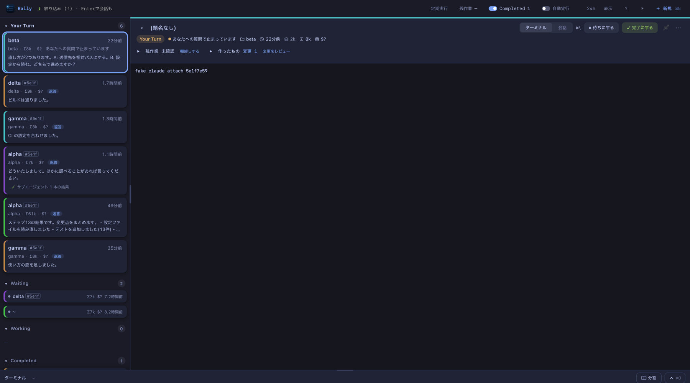

# Rally

**Every coding-agent session on your Mac in one list: whose turn it is, what each one last said, and a place to answer it.**

Rally reads the transcripts that Claude Code, Codex, Antigravity, Gemini CLI and Cursor
already write on your machine and sorts every session into four lanes: **Your Turn**,
**Waiting**, **Working** and **Completed**. From the same window you answer permission
prompts, send the next message, start new sessions, and open a session's real terminal.
It is a macOS app and a Node CLI; nothing leaves the Mac.

<picture>
  <source srcset="docs/board-light.png" media="(prefers-color-scheme: light)">
  
</picture>

*The screenshot shows made-up fixture sessions.*

## Install

**The app** (macOS 14 or later). Download `Rally-<version>-arm64.dmg` (Apple silicon) or
`-x86_64.dmg` (Intel) from the [releases](https://github.com/sue738/rally/releases)
and drag **Rally** to Applications. Node is bundled; nothing else needs installing.

The app is ad-hoc signed but not notarized, so macOS blocks the first open of a download:
open it once, then **System Settings → Privacy & Security → Open Anyway**. Or clear the
quarantine yourself: `xattr -dr com.apple.quarantine /Applications/Rally.app`.

**Homebrew** (a personal tap; the cask clears the quarantine for you):

```bash
brew install --cask sue738/tap/rally
```

**The CLI only** (Node ≥ 22.13; serves the same page in your browser):

```bash
npx github:sue738/rally          # opens http://127.0.0.1:7331/
npx github:sue738/rally now      # the lanes as text
# or
git clone https://github.com/sue738/rally && cd rally && node bin/rally.js
```

`node bin/rally.js --help` lists the other commands (`run`, `reply`, `queue`, `perm`, `done`, …).

## First run

Open Rally. It reads sessions touched in the last 24 hours, and the last 7 days while
**Completed** is shown (**+** / **−** widen or narrow that) and refreshes on its own. **⌥⌘K** shows or hides the window from
anywhere; closing the window parks it instead of quitting. *Start at Login* is in the app
menu. The UI is in Japanese.

To answer Claude Code permission prompts from Rally, add its hook to
`~/.claude/settings.json` yourself (Rally never edits that file; the app keeps
`~/.rally/bin/permhook` pointing at its own copy):

```json
"hooks": { "PermissionRequest": [{ "matcher": "*", "hooks": [{ "type": "command",
  "command": "/Users/<you>/.rally/bin/permhook", "timeout": 86400 }] }] }
```

When Rally is not open, the hook prints nothing and the prompt stays in the terminal as usual.

To show Claude's 5-hour and weekly allowance in the header, let Rally see what Claude Code
hands its status line. Set `statusLine` in the same file; an existing status line goes after
it and keeps printing as before (the header's **Claude の利用枠を出す** button shows the exact line):

```json
"statusLine": { "type": "command", "command": "~/.rally/bin/statusline ~/your/statusline" }
```

Codex's allowance needs nothing: it is in Codex's own session logs.

## The lanes

| lane | what is in it |
|---|---|
| **Your Turn** | waiting on you: a permission prompt or a question on top, then sessions that finished their turn, or where you spoke last and nothing followed |
| **Waiting** | quiet for 6–24 hours. Not finished, just possibly forgotten |
| **Working** | wrote within the last minute, has a subagent still running, or `claude agents` says it is busy |
| **Completed** | sessions you marked done, anything quiet for over a day, one-shot and machine-started runs. Hidden until you turn on **Completed** in the header |

The lane comes from each session's last transcript entries and its subagents', corrected
by the live process state from `claude agents --json`. A card entering Your Turn raises a
macOS notification and bumps the Dock badge.

The header's **表示** (Display) chooses what a card shows: project, agent, model, Σ total
tokens, the API-equivalent cost, context size, the last message, and time since it last
moved. The cost is what the session would have cost on the API, as a size to compare, not
a bill (`$?` when a model has no known rate; none for Codex).

## What you can do

- **Answer permission prompts.** A new prompt appears as a small card in the corner of
  the window, without taking focus, with the prompt's own choices (allow / don't ask
  again / deny). The same prompt shows in the open session's conversation, where ⌘Y /
  ⌘⇧Y allow or deny it. Questions (AskUserQuestion) and plan approvals work the same way.
- **Send a message.** Enter in the panel's box sends it to that session: an idle one is
  resumed in place, a background one is continued, one open in a terminal is typed into.
  A chip in the send row changes that:
  - **今の作業後に送る** (send after the current work): the message is held until the
    session is next idle, one per idle turn, in order. ⌥⏎ flips it for one send.
  - ⌘C (with nothing selected) takes back what you just sent.
- **Use the session's real terminal.** A Claude card's panel opens on `claude attach`
  for a background session, or **ここで再開** (resume here) for one that is not running.
  Codex and Antigravity sessions reopen with `codex resume` / `agy --conversation`.
  ⌘\ switches between the terminal and the conversation. Terminals run in a small host
  (`rally-ptyd`) that outlives the app, so quitting or updating Rally only detaches them.
  The strip at the bottom holds shells and splits (⌘J shows it, ⌘T opens a shell, ⌘D splits).
- **Start a new session** with **＋ 新規** (⌘N): pick an agent (claude, codex,
  antigravity), a folder, a model, and a permission mode (plan / accept edits / auto;
  bypass is never offered). Claude and Codex can start in a fresh git worktree, and
  ×2 / ×3 run the same ask side by side in separate worktrees; Claude can also be
  allowed to drive Chrome (`--chrome`). Files and pasted images can go with the message.
- **Follow subagents.** Subagents are nested under their parent: running ones, then the
  finished ones as its results. Click one to read its conversation.
- **Review what a session changed** (D): every file it wrote or edited, with git's diff.
- **Mark sessions done** (完了にする), and ask a session what is still open
  (残作業, a `claude -p` read of the conversation's tail).
- **Keyboard.** ⌘K opens the palette: every session and every button, fuzzy-searched.
  ↑↓ move through cards, Enter opens, `/` in the box lists skills, `@` completes file
  names, `?` shows every key. Keys can be rebound (設定 in the `?` list).

## Supported agents

| agent | listed | conversation | send / start | answer prompts | panel terminal |
|---|---|---|---|---|---|
| Claude Code | yes | yes | yes | yes (hook above) | `claude attach` / resume |
| Codex CLI | yes | yes | yes (`codex exec`) | no (runs headless in a sandbox mode) | `codex resume` |
| Antigravity (`agy`) | sessions Rally started | yes | yes (`agy -p`) | no (denied actions are named on the card) | `agy --conversation` |
| Gemini CLI | yes | no | no | no | no |
| Cursor | yes | no | no | no | no |

A card in **Working** counts down to when its turn is likely to end (`⏱ あと5:55`), also at the top of its
panel. There is no way to know how hard a request is (its wording, length and the context size say nothing), so it is
estimated from how long earlier turns took: this session's, the folder's and everyone's, newer ones and ones with a similar
number of tool calls so far counting more, compared only with those that ran longer than this one already has. It changes as the turn goes on, and
says so when it runs longer than any before; when the usual range is wide it shows the range (あと約2〜15分), not one number.
It is right to within a factor of two about a third of the time (`node scripts/eta-backtest.js` replays the past to check
that; `rally eta-report` shows the live log).

Only transcripts modified within the chosen hours are read. The header also shows how
much of the Claude and Codex 5-hour and weekly allowance is left, when those numbers are
on disk.

## Privacy

- No account, no telemetry, no server of ours. The app listens on no port; it runs
  `node rally.js state` once per refresh. The CLI's browser server binds to 127.0.0.1
  and refuses other Hosts and cross-site requests.
- **Read:** the agents' transcripts (`~/.claude`, `~/.codex`, Gemini's and Cursor's
  stores), `claude agents --json`, and the rate limits Claude Code hands the status line (when set up above).
- **Written:** Rally's own files under `~/.rally/` (backlog, queue, run logs,
  attachments, caches). An agent is only written to when you send, start or finish.
- Card titles and 残作業 are generated with your own `claude` CLI and count toward your
  usage (`RALLY_NO_ENRICH=1` turns titles off).

## Building from source

Requires Xcode's command line tools.

```bash
cd app && ./build.sh          # dist/Rally.app for this Mac's architecture
./release.sh                  # release/Rally-<version>-{arm64,x86_64}.dmg + SHA256SUMS
```

`build.sh` bundles the official nodejs.org build (checked against its SHASUMS256.txt);
`RALLY_BUNDLE_NODE=0` leaves it out. `Casks/rally.rb` takes its checksums from
`SHA256SUMS`, and the version everywhere is `package.json`'s. The CLI has no
dependencies; the transcript readers are vendored in `lib/vendor/`.

## Tests

```bash
node test/test.js             # CLI, server, lanes, dispatch, queue …
node test/page.js             # the page's script against a stub DOM
app/selftest.sh [scenario]    # launches the real app on a fixture home and screenshots it
scripts/verify.sh             # the above in proportion to what changed: unit tests, a build, only the scenarios the changed files can reach
```

`scripts/verify.sh --plan` says what it would run and how long that takes (a looks-only change is a few
minutes, not the ten of the full run); `--full` runs every scenario, `--bg` runs detached and returns at once.

The selftest runs with its own `HOME`, made-up sessions (`test/fixtures/selftest-home.js`)
and a fake `claude`, so no real session is read or sent to.

## Renamed from Hotaru

Rally was called Hotaru, and before that Ika, Genba and AgentKanban. On first start an
old `~/.hotaru`, `~/.ika`, `~/.genba` or `~/.agentkanban` is moved to `~/.rally` and left
as a link to it. `HOTARU_*`, `IKA_*`, `GENBA_*` and `AGENTKANBAN_*` variables are read when
the `RALLY_*` one is not set, and `hotaru`, `ika` and `agentkanban` still work as commands.

## License

MIT
